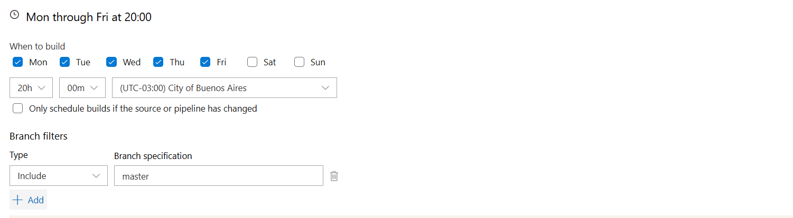
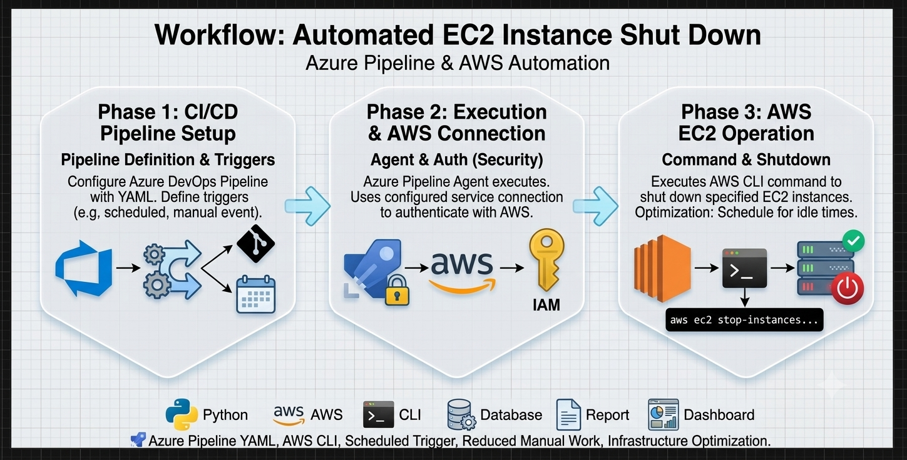

# Automation pipeline: Shut down an Ec2 instance
This repository features an Azure Pipeline designed to automate the process of shut down an EC2 instance in AWS. Includes a command to shut down EC2. This configuration optimizes infrastructure management, reduces manual work, and ensures that instances are properly shut down.

### 🛠️For the use the schema
* Aws account and a EC2
* Azure devOps account
* * Install the [AWS Toolkit for Azure DevOps](https://marketplace.visualstudio.com/items?itemName=AmazonWebServices.aws-vsts-tools) extension
* * Create an AWS service connection
* * Create new pipeline
* * Set the variables in azure-pipelines.yml

#### AWS service connection
The pipeline uses the `AWSShellScript@1` task, which authenticates through an Azure DevOps service connection instead of access keys stored in variables.

- Go to **Project Settings → Service connections → New service connection → AWS**
- Enter the Access Key ID and Secret Access Key (or a Role ARN to assume)
- Name it `aws-dev-connection` (or update `awsCredentials` in azure-pipelines.yml to match)

#### Pipeline variables
Defined directly in azure-pipelines.yml:

```yaml
variables:
  AWS_REGION: 'us-east-1'
  AWS_INSTANCE_ID: 'i-xxxxxxxxxxxxxxxxx,i-yyyyyyyyyyyyyyyyy'
```

Replace them with your actual region and instance IDs. `AWS_INSTANCE_ID` accepts one ID or several IDs separated by commas.

### ⚡Triggers in Azure Devops
We can configure pipelines to run on the days we need:
- Create pipeline in Azure Devops
- Setting pipeline with this repository and azure-pipelines.yml
- Select Triggers and Scheduled
- Scheduled detail:

<div align="center">
  
</div>

### 🔄 Workflow
Pipeline workflow overview:

<div align="center">
  
</div>
